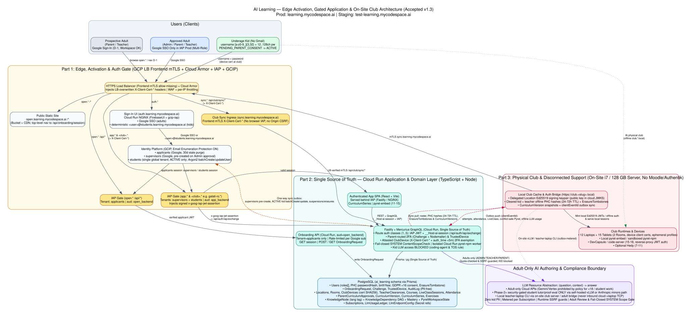

# Project Elements Overview

> **Status: `Accepted (v1.3 — 2026-11-16)`**
>
> This is the authoritative architectural and product overview for **AI
> Learning**. Per [WORKFLOW-LOCAL.md](../WORKFLOW-LOCAL.md), feature
> implementation must align with this specification and keep it current when
> core requirements, schema boundaries, or constraints change.

## Purpose

**AI Learning** is an invitation- and subscription-governed educational platform
primarily for **kids** (across home access and physical coding-club locations),
supported by **parents**, **teachers**, and **admins**. It combines:

1. **Curriculum & Open Content (Off-Google & Immutable):** Curricula authored
   locally (`CurriculumSeries` such as *"Learn Romanian Part 1"*) or copied as
   immutable `CurriculumVersion` snapshots from well-known **open-source /
   Creative Commons** curricula (e.g., BootstrapWorld with self-hosted modules
   replacing `shared-gdrive`, embedded `pyret-embed` + `pyret-npm`, and age
   programs `7–11`, `11–15`, `15–18`).
2. **Knowledge Graph & Prerequisite Routing:** Discrete pieces of knowledge
   (`KnowledgeNode`, carrying language designators defaulting to English `en`)
   connected by prerequisite dependencies (e.g., *radicals / square roots* →
   *degree 2 equations with real numbers*), guiding students through missing
   prerequisites first.
3. **Edge-Gated Auth & Single-Source-of-Truth Backend + Disconnected Club
   Support:** GCP Load Balancer + Cloud Armor + IAP (External Identities) +
   GCIP (`applicants`, `supervisors`, `students`) guard `learning.mycodespace.ai`
   (and `test-learning.mycodespace.ai` for staging). Fastify + Mercurius GraphQL
   + Prisma + PostgreSQL (`ai_learning` schema) is the **single source of
   truth** — owning `User`, parent-routed 2FA (`Challenge` / `TrustedDevice`),
   GDPR `<16` consent, clearances, one-way sync to GCIP, signed JWT/JWKS
   issuance, and location-scoped offline caches (with delegated local Ed25519
   signing keys) for the on-site club server (`i7 / 128 GB RAM`). **Moodle and
   Authentik are excluded.**
4. **AI-Assisted Authoring & Gated Compliance:** AI helps adults generate
   curricula/exercises, tag knowledge, trace dependencies, and verify delegated
   `Course` scope promises — strictly metered per subscription, reviewed by
   adults before students see outputs, and never exposing commercial `<18`-banned
   APIs (such as Gemini/Vertex) to children (enforced as a coding-agent rule and
   security-review gate).

## Current Baseline (Cut 1) & Phase-1 Migration Notes

Cut 1 (implemented, pending live database/OAuth/SMTP acceptance) covers
invitation-only accounts (`users`, `sessions`, `challenges`, `trusted_devices`
in PostgreSQL schema `ai_learning`), `@gmail.com` OAuth signup, optional
username/password with email 2FA and 30-day trusted browsers, and a minimal
signed-in account page. See
[r-account-001-invitation-auth.md](requirements/product/r-account-001-invitation-auth.md)
and [CURRENT-STATUS.md](../CURRENT-STATUS.md).

Moving from Cut 1 to Phase 1 explicitly requires:
- **Prisma & SQL baseline:** Freeze `0001_initial` (plus snapshot
  `prisma/snapshots/0001_initial.prisma` and stop `npm run db:sql` from
  overwriting `0001_initial`), establish `_prisma_migrations` baseline cleanly
  (noting `scripts/db-apply.ts` only runs `0001_initial` without writing
  `_prisma_migrations`), update `prisma.config.ts` to compose the datasource URL
  from `POSTGRES_*` env vars (URL-encoding password, keeping `127.0.0.1:1` as
  offline fallback for `migrate resolve`), and replace `scripts/schema-sql.ts`'s
  `=== 4` / `--from-empty` guard so `0002_*` migrations generate offline via
  `--from-schema <frozen-snapshot>`.
- **Schema & Cut 1 auth transition:** Make `User.email` and `googleSubject`
  nullable (and GraphQL `User.email: String`), extend `SignInType` enum for
  GCIP/IAP and club-offline sign-ins, remove `signInTypes`/`lastSignInType`
  `GOOGLE` defaults for kids, backfill `active` into `accountStatus` before
  dropping the boolean column (no split-brain boolean), update kid 2FA to
  resolve `guardianUserId`'s verified `ACTIVE` email, replace `approved()`
  reading `config/approved-gmail.txt` on disk (`src/app.ts`) with PostgreSQL
  checks, relax `@gmail.com`-only validation (`src/security.ts`) for verified
  Google Workspace accounts, make `GOOGLE_CLIENT_ID`/`SECRET` optional in IAP
  prod mode, add `AUTH_MODE` / IAP audiences / GCIP tenant / club mTLS config in
  `src/config.ts`, and retire Cut 1's direct `/api/auth/google*` and adult
  local-password login in IAP prod mode (keeping them only for local DevCapsule
  dev mode).
- **HTTP, GraphQL & Readiness:** Lift `bodyLimit: 8192`, configure exact
  `trustProxy` hop count behind GCP LB/IAP, replace in-memory rate-limit store
  with distributed/edge-backed limits, update Fastify Helmet CSP for
  `pyret-embed` / Bootstrap modules (FirebaseUI runs on NGINX `signin-ui`),
  validate multi-origin (`open.*`, `app.*`, active `<club>.*`) with `/api/club/sync/*`
  mTLS Origin-CSRF exemption, add SPA fallback for `@fastify/static` (excluding
  `/api/*` and `/graphql`), add `GET /api/ready` (`SELECT 1`), raise Mercurius
  `queryDepth` beyond `3`, map `401`/`403`/`429` cleanly, add idempotent
  `scripts/bootstrap-admin.ts`, and fix `package.json` `"format"` glob
  (`"src/*.ts"` → `"src/**/*.ts"`).

## Overview Documents

- [General Requirements & Personas](overview/requirements.md)
- [Conceptual Schema](overview/conceptual-schema.md)
- [Design Constraints](overview/design-constraints.md)
- [Fixed Technology Choices & Rationale](overview/tech-choices.md)
- [Edge Auth, IAP Handshake & Disconnected Club Contracts](overview/edge-and-sync-contracts.md)
- [Areas Open for LLM / Agent Proposals](overview/llm-discretion.md)
- Architecture & Auth Flow Diagram:
  [architecture-auth-flow.dot](overview/architecture-auth-flow.dot) |
  [architecture-auth-flow.svg](overview/architecture-auth-flow.svg)
- Reference research & prototypes (not adopted verbatim where stack differs):
  - [subscription-account-activation](other/subscription-account-activation/README.md)
  - [AiAsTutor](other/AiAsTutor/README.md)

## Roadmap & Deferred Items

- **Phase-2+ security-gated student AI:** Interactive `tutor`, Design Recipe
  `pair-programmer`, and LLM-backed `FREE_FORM_PROOF` evaluation (strictly on
  self-hosted `vLLM` or Anthropic minors-compliant API) remain deferred behind
  explicit owner direction and formal security review.
- **Multilingual RAG tag discovery (post-prototype roadmap):** Cross-lingual
  RAG/semantic search over `KnowledgeNode` tags and descriptions (each
  carrying a language designator defaulting to English, so e.g. a teacher
  working in Romanian can easily find `theorem_of_pythagoras`, while a Tamil
  curriculum isn't forced through English) is not required in the first
  prototype, and sits on the PostgreSQL (`pgvector`) roadmap.
- **Deferred implementation details:** Billing/payment integration, future
  tablet/browser passwordless kid auth, and remaining architectural choices (see
  [Areas Open for LLM / Agent Proposals](overview/llm-discretion.md)).
